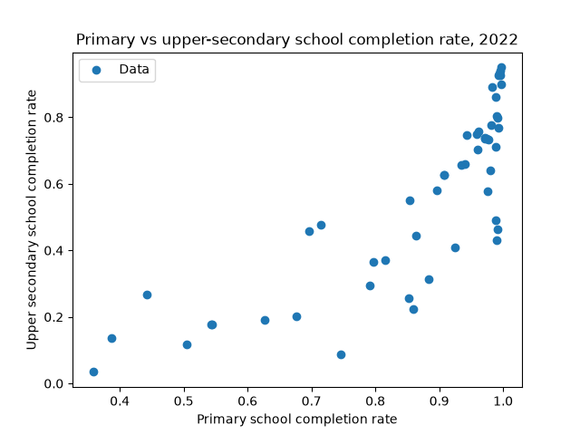
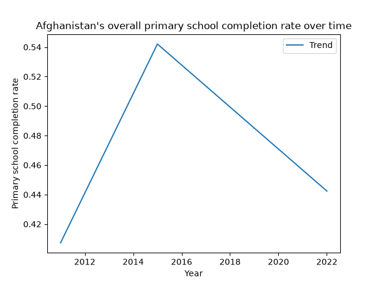
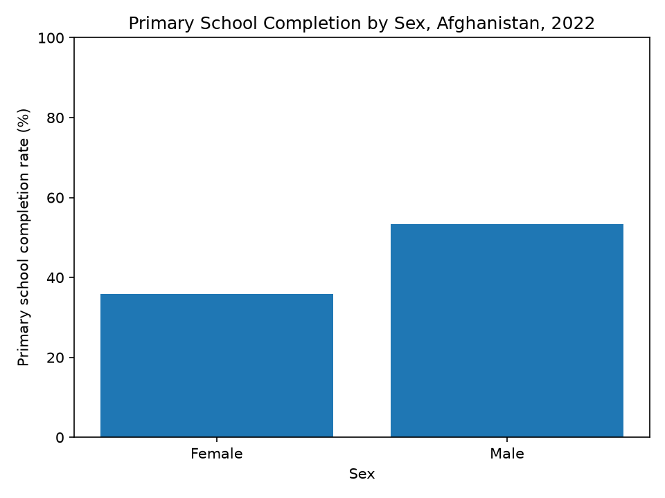
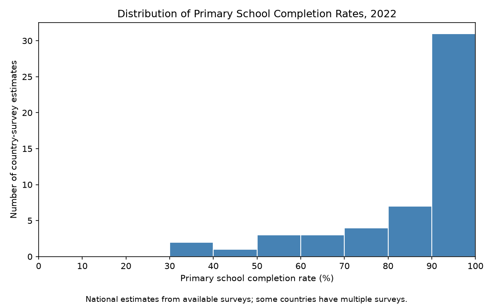
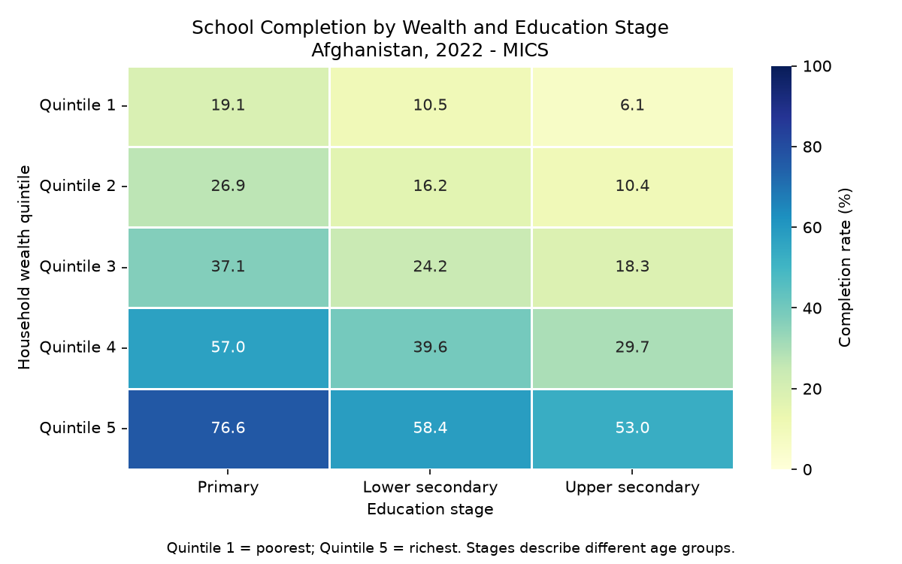
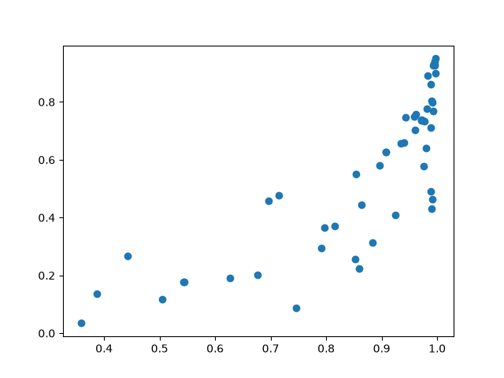
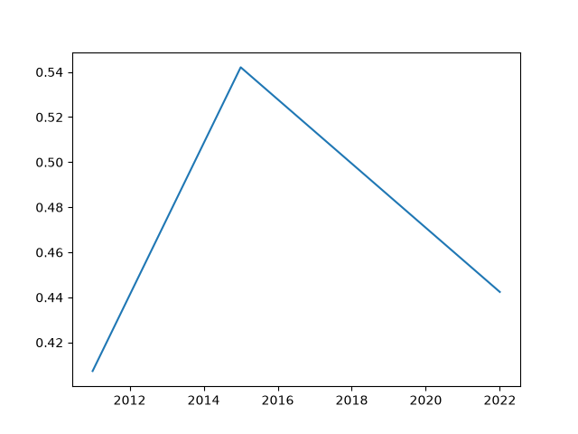
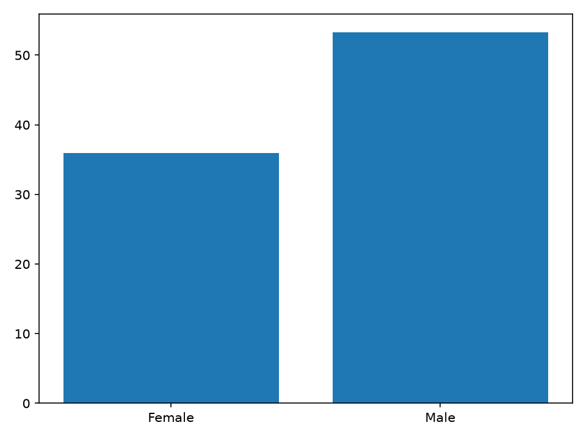

# Week 7 Instructions

In this week, you will learn how to:
- prepare a dataset for visualizations
    - very basic data cleaning
        - remove missing values and outliers
- know about some types of plots
    - scatter plots
    - line plots
    - bar charts
    - histograms
    - heat maps
- be able to construct these plots
- be able to start from a prompt/idea and wrangle the data into a visualization, start to finish

## Dataset Preparation

One of the first parts of creating visualization is preparing the data into a format that is ingestible by our visualization libraries. Last week (actually, two weeks ago), we focused on taking a Pandas DataFrame and being able to filter the dataset and select certain columns. For a reminder, the below is how you import `data` from the CSV in the repo, filter data to only `year == 2022`, filter to `country == "Afghanistan"`, and print only the columns named `comp_prim_v2_m` and `comp_lowsec_v2_m`.

```{python}
from pathlib import Path
import matplotlib.pyplot as plt
import pandas as pd

data = pd.read_csv("data/week-5/1779962350-wide_2026_apr_v2.csv", encoding="latin-1", low_memory=False)

data = data[data["year"] == 2015]
data = data[data["country"] == "Afghanistan"]
print(data[["comp_prim_v2_m", "comp_lowsec_v2_m"]])
```

Do note that the above approach saves the filtered version of `data` as `data`, so the original, unfiltered version of `data` is gone. This is remedied by creating a new variable and setting that equal to the filtered version so that the old `data` still exists. 

Now, you may filter the dataset and print it, but that does not ensure that the data is nice and clean with valid values. In some cases, there may be `NA`'s, there may be `NaN`'s, there may be `None`'s, and there may be impossible values given the contents of the column (for instance, the value `green` should not be in a column of all numbers). Many, many datasets are incredibly messy, and as data scientists, our job is to clean up some of this data, just enough that we can draw insights from these. In fact, if you run the above code, you will see near the end of the printed data, there are some `NaN` values. These are Not a Number. And if we want to do analysis with this, we need to remove them.

We can do that by using `.dropna(subset=[])`. `.dropna()` drops rows with missing values. For example:

```{python}
from pathlib import Path
import matplotlib.pyplot as plt
import pandas as pd

data = pd.read_csv("data/week-5/1779962350-wide_2026_apr_v2.csv", encoding="latin-1", low_memory=False)

data = data[data["year"] == 2015]
data = data[data["country"] == "Afghanistan"]
data = data.dropna(subset=["comp_prim_v2_m", "comp_lowsec_v2_m"])
print(data[["comp_prim_v2_m", "comp_lowsec_v2_m"]])
```

Printing this, it will print the two columns, except it no longer has the `NaN`s. Strong recommendation: use `subset=[]` when calling `.dropna()`. If you run `.dropna()` without the `subset` on a dataframe, it will remove all rows that have missing values, even if they're in completely unrelated columns. Know what data you need and what data it is fine to leave messy. 

For all of the below visualizations as well as analysis and machine learning, it is often necessary to get rid of these missing values so that you can do further analysis without datapoints that are completely irrelevant.

Additionally, there may be a case where you will need to sort a dataset based on a column or multiple columns. To do that, we use `.sort_values()`.

```{python}
from pathlib import Path
import matplotlib.pyplot as plt
import pandas as pd

data = pd.read_csv("data/week-5/1779962350-wide_2026_apr_v2.csv", encoding="latin-1", low_memory=False)

data = data[data["year"] == 2015]
data = data[data["country"] == "Afghanistan"]
data = data.dropna(subset=["comp_prim_v2_m", "comp_lowsec_v2_m"])
data = data.sort_values("comp_prim_v2_m")
print(data[["comp_prim_v2_m", "comp_lowsec_v2_m"]])
```

This will sort ascending. To sort descending, add `ascending = False` to the arguments of `sort_values`. 

## A Short Introduction to Visualizations

You know what a visualization is. Odds are, you've seen these plots, whether in math class, in articles, in the news, wherever. Odds are, you've probably made one of these in your life. So the point of this is to expose you to a little bit more and give some names to what you've seen previously.

This is a scatter plot.



This is a line plot.



This is a bar chart.



This is a histogram.



This is a heat map.



Of course, there are way, way, way too many types of visualizations to show in one Markdown instructions file. Today, we're covering the first three since they're slightly easier. Next week, we'll be covering the remaining 2 as well as slightly more advanced data visualizations and tying it all together.

## The Scatter Plot

The scatter plot is a very simple plot that compares two continuous variables (one on the x-axis, one on the y-axis). Continuous just means these variables are like an actual number and not like some kind of category. You've made this plenty of times in Algebra 1 or whatever, now we're just making this at scale using code.

Firstly, we want to isolate our x and our y. Let's say we want to make a scatter plot that plots the relationship between primary school completion rate and upper-secondary school completion rate in 2022 for all countries. To do that, we need to clean our data and isolate our x and y.

```{python}
from pathlib import Path
import matplotlib.pyplot as plt
import pandas as pd

data = pd.read_csv("data/week-5/1779962350-wide_2026_apr_v2.csv", encoding="latin-1", low_memory=False)

plot_data = data[(data["year"] == 2022) & (data["category"] == "Total")]
# The data["category"] == "Total" is so that we get whole country numbers, rather than just a demographic.

plot_data = plot_data.dropna(subset=["comp_prim_v2_m", "comp_upsec_v2_m"])

x = plot_data["comp_prim_v2_m"]
y = plot_data["comp_upsec_v2_m"]
```

And now, we have a cleaned x and y, where our x is the primary school completion rate for countries in 2022, and y is the upper-secondary school completion rate for countries in 2022.

To plot these on a scatter plot, we write:

```{python}
plt.scatter(x, y, label = "Data")
plt.show()
```



This will give us a scatter plot with our x and y. Let's add some labels, a legend, and a title.

```{python}
plt.scatter(x, y, label = "Data")
plt.xlabel("Primary school completion rate")
plt.ylabel("Upper secondary school completion rate")
plt.legend()
plt.title("Primary vs upper-secondary school completion rate, 2022")
plt.show()
```


Of course, this is a lot more customizable than just this. Matplotlib provides some ways to customize these scatterplots, but for some really visually appealing scatterplots, you may want to experiment with seaborn. We'll get into some more of these customizations next week.

## The Line Plot

The line plot is similar to the scatter plot in that it has two continuous variables, but it draws a line between points. You may be wondering, why even have this? If the data is messier and there are more points, it may make more sense to use a scatter plot, but if the data is cleaner and you're trying to illustrate a trend, a line plot may be useful. 

Let's say we want to see a country's primary school completion rate over the years. We could make a scatter plot, but let's make a line plot. Let's say we want to look at Afghanistan's overall primary school completion rate over the years.

```{python}
from pathlib import Path
import matplotlib.pyplot as plt
import pandas as pd

data = pd.read_csv("data/week-5/1779962350-wide_2026_apr_v2.csv", encoding="latin-1", low_memory=False)

plot_data = data[(data["country"] == "Afghanistan") & (data["category"] == "Total")]

plot_data = plot_data.dropna(subset=["comp_prim_v2_m"])
plot_data = plot_data.sort_values("year")

x = plot_data["year"]
y = plot_data["comp_prim_v2_m"]
```

We have cleaned our data and isolated our x and our y. One note about line plots is that it draws lines between sequential data points in the data provided, so if it's out of order, it will draw some weird lines. Sorting by year ensures the line connects points in chronological order rather than their order in the CSV.

We can run:

```{python}
plt.plot(x, y, label = "Trend")
plt.show()
```



to get our line plot. Let's add some labels and a title. 

```{python}
plt.plot(x, y, label = "Trend")
plt.xlabel("Year")
plt.ylabel("Primary school completion rate")
plt.title("Afghanistan's overall primary school completion rate over time")
plt.legend()
plt.show()
```


## The Bar Chart

A bar chart is a little different. Typically, it's either a series of vertical or horizontal bars with some continuous variable compared over some categorical variable.

Let's say we want to look at the primary school completion rate between males and females in 2022 in Afghanistan. We first isolate our x and y.

```{python}
import pandas as pd
import matplotlib.pyplot as plt

data = pd.read_csv("data/week-5/1779962350-wide_2026_apr_v2.csv", encoding="latin-1", low_memory=False)

plot_data = data[(data["country"] == "Afghanistan") & (data["year"] == 2022) & (data["survey"] == "MICS") & (data["category"] == "Sex")
]
plot_data = plot_data.dropna(subset=["sex", "comp_prim_v2_m"])

x = plot_data["sex"]
y = plot_data["comp_prim_v2_m"] * 100
```

We multiply y by 100 in this case because we want percentage points.

Then, we can run:

```{python}
plt.bar(x, y)
plt.show()
```



And to add labels and a title:

```{python}

plt.bar(x, y)
plt.xlabel("Sex")
plt.ylabel("Primary school completion rate (%)")
plt.title("Primary School Completion by Sex, Afghanistan, 2022")
plt.ylim(0, 100)
plt.show()
```


## Your Turn

Each of you guys have been given a `week-7-instructions.md` file with two instructions to make plots. Using the instructions from this markdown as well as any help from the internet or me or elsewhere, try your best to make these visualizations. Once you've made the visualizations, take a screenshot, and add it to the plots folder in this repo. Put your code for Plot 1 in your `plot-1.py` and similarly for `plot-2.py`. If you want to experiment, feel free to put that in `experimentation.py`. 

For all your changes, please make a branch, make your commits on the branch, push the branch, and make a PR. I will review your code and your visualizations, and if they're good, I will approve, but if I have major concerns, I may request for specific changes.
